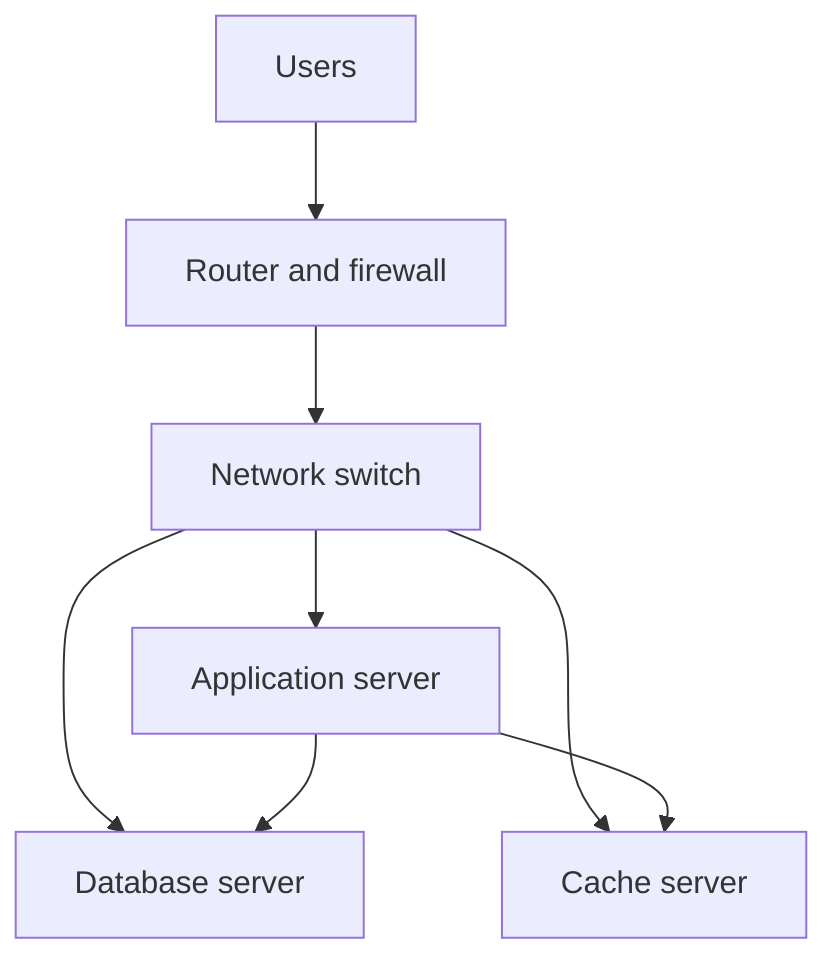

# Lesson 02 — On-premises Infrastructure

## Learning objectives
Understand infrastructure ownership, failure domains, capacity planning, and deployment trade-offs.

## Core concepts
- On-premises: infrastructure operated under an organization's control, typically at its own premises or data center.
- Infrastructure stack: physical facilities, hardware, optional virtualization, operating system, runtime, application and data.
- Switch: connects devices within a network. Router: routes traffic between networks. Firewall: enforces traffic rules. UPS: provides temporary backup power.
- Single Point of Failure (SPOF): a component whose failure can interrupt a required service.
- Redundancy: additional components that reduce dependence on a single component. High availability also requires appropriate failover, monitoring and testing.
- Failure domain: a group of resources exposed to a common failure.

Each service can remain a SPOF. Shared power and networking can introduce common failure risks.

## Capacity planning
Over-provisioning allocates more capacity than demand requires. Under-provisioning allocates insufficient capacity. For an illustrative workload requiring 4 vCPU for eleven months and 32 vCPU for one month, fixed capacity of 32 vCPU leaves 87.5% unused during low-demand months; fixed capacity of 4 vCPU leaves 87.5% of peak demand unmet. These are simplified capacity figures, not measured utilization.

## Cost model
CapEx includes capital investments such as purchased servers. OpEx includes recurring operating expenses such as electricity, staffing and typical cloud usage charges. Actual accounting treatment depends on contracts and accounting policy.

Illustrative three-year cost: VND 250 million initial investment + VND 25 million per month × 36 = VND 1.15 billion. Compare total cost of ownership, not only hardware prices.

## Architecture decision criteria
Compare time to market, demand variability, existing assets, operational expertise, compliance, data residency, latency, security, portability and total cost. Neither cloud nor on-premises is universally cheaper or safer.

## Local design lab
Design a small e-commerce infrastructure with an application, PostgreSQL and Redis. Draw its network and dependency diagram. Identify component and shared failure domains. Propose redundancy and failover where justified. Compare fixed capacity of 4 and 32 vCPU against the example workload. Record assumptions and trade-offs in an architecture decision record.

## Acceptance criteria
- [ ] Diagram identifies service dependencies and shared infrastructure.
- [ ] Component and infrastructure SPOFs are documented.
- [ ] Capacity calculations and assumptions are correct.
- [ ] CapEx and OpEx are distinguished.
- [ ] Deployment recommendation is justified by business constraints.

No AWS resources are required for this lab.
